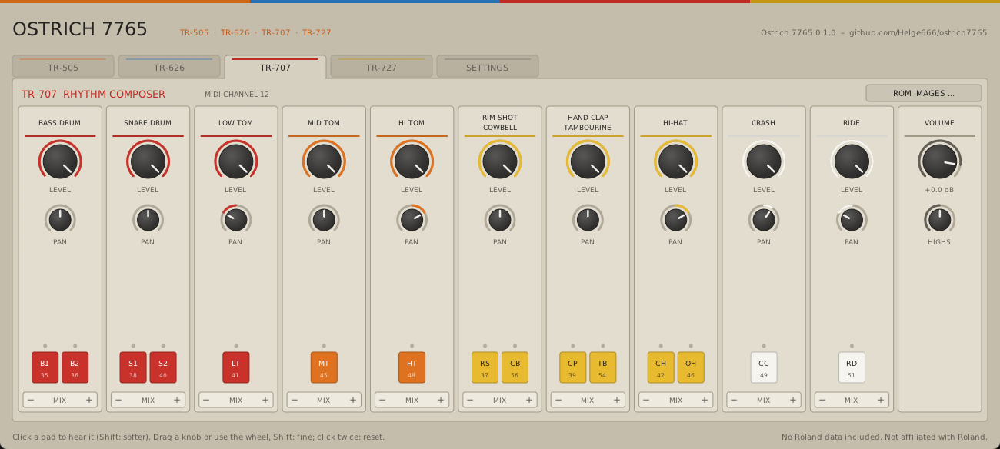
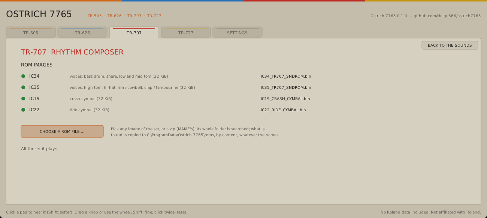
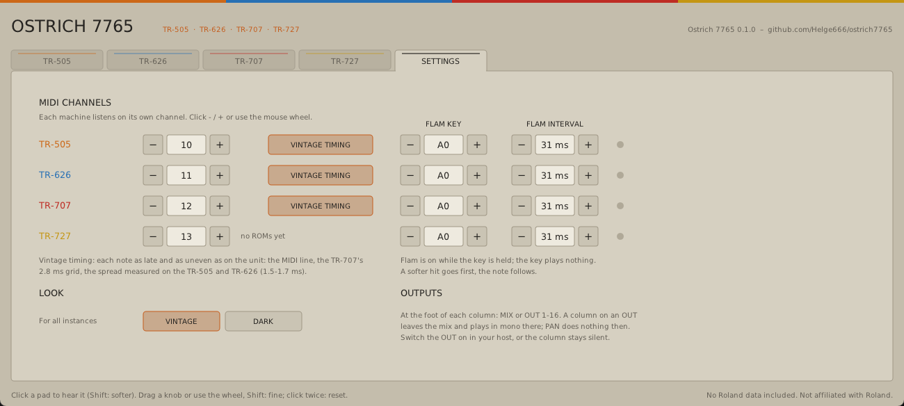

# Ostrich 7765

The sounds of four sample-based **Roland drum machines** of the 1980s as a VST3/CLAP plugin
and a standalone program: **TR-505, TR-626, TR-707 and TR-727**. A non-commercial fan
project.

**[Download the latest release](https://github.com/Helge666/ostrich7765/releases/latest)**
for Windows or Linux, free of charge. [How to install it](#install).

> **First release, still growing.** The TR-505, TR-626 and TR-707 play, each with its panel,
> the TR-626's pitch, vintage timing and mono outputs. The TR-727 waits for its sound ROMs.
> See [ROADMAP.md](ROADMAP.md).

**It is not a sample player.** Ostrich 7765 reads the machines' **original sound ROMs**
(your own images) instead of playing recordings of them: a recording always carries the
recording hardware with it, and a set of samples knows nothing of how the machine plays
them. Around the ROM data it rebuilds, in part, what each machine does with it: sample
rates and the order in which the sounds are read, accent from the velocity, envelopes,
which sounds share a voice and cut each other, levels and panning, and (for the TR-707)
the analogue voice board with its filters. All of it is worked out from the ROMs, firmware,
documentation and measurements of real units ([analysis/](analysis/README-ANALYSIS.md)).
It does not run the machines' firmware, and it has no sequencer: the sounds are played by
MIDI.

You need your own ROM images. **This repository contains no Roland data and never will.**

## Install

1. On the [release page](https://github.com/Helge666/ostrich7765/releases/latest), under
   *Assets*, download `Ostrich7765-Windows.zip` or `Ostrich7765-Linux.zip` and unpack it.
2. Copy the folder `Ostrich7765.vst3` to `C:\Program Files\Common Files\VST3\` (Windows) or
   `~/.vst3/` (Linux), and let your music program scan for new plugins. The zip's
   `INSTALL.txt` also covers CLAP and the standalone program.
3. Open Ostrich 7765, go to a machine's tab, click **ROM IMAGES ...**, then
   **CHOOSE A ROM FILE ...** and pick one of your ROM images or a zip of them. The panel
   shows what it found. Which files each machine needs: [roms/README.md](roms/README.md).
4. Send MIDI on channel 10 for the TR-505, 11 for the TR-626, 12 for the TR-707. The pads
   and notes are on each machine's page.

## What it does

- **Four machines in one plugin**, each on its own tab and its own MIDI channel (TR-505 10,
  TR-626 11, TR-707 12, TR-727 13; set on the SETTINGS page), all playing at the same time.
  The TR-727 is prepared but needs its sound ROMs, which have not been dumped yet.
- **A panel per machine**: a column per group of sounds with its LEVEL, its PAN (starting
  where the unit has it) and its pads (each with its MIDI note; click one to hear it), and
  the machine's VOLUME. The TR-626 also has its PITCH per sound (-7..+7, as on the unit; it
  sets the pad clicked last), the TR-707 HIGHS, from the circuit as documented to a
  recording of a real unit ([analysis/TR-707.md](analysis/TR-707.md)). Two looks, VINTAGE
  (the units' beige) and DARK, chosen on the SETTINGS page.
- **16 mono outputs** besides the stereo mix: at the foot of each column, MIX or OUT 1-16.
  A column on an OUT leaves the mix; several columns can share one. Switch the OUT on in
  your host, or the column stays silent.
- **Vintage timing (per machine, on by default):** each note as late and as uneven as on
  the unit: the MIDI line, the TR-707's 2.8 ms grid, the spread measured on the TR-505 and
  TR-626 ([analysis/TIMING.md](analysis/TIMING.md)).
- **Flam:** while a key note of the machine is held (SETTINGS, default A0), each note gets a
  softer hit before it, with the four intervals of the units.

Formats: VST3, CLAP and a standalone program on Windows (64-bit); VST3, CLAP and a JACK
standalone on Linux. No macOS build yet.

## Building

[BUILDING.md](BUILDING.md). What is known about the hardware:
[analysis/](analysis/README-ANALYSIS.md). What is planned: [ROADMAP.md](ROADMAP.md).

## Licences

Ostrich 7765 is distributed under the GNU General Public License, version 3 or later
([LICENSE](LICENSE)). Third-party code and its licences: [THIRD-PARTY.md](THIRD-PARTY.md).

"Roland", "TR-505", "TR-626", "TR-707" and "TR-727" are trademarks of Roland Corporation.
This project is not affiliated with Roland.
